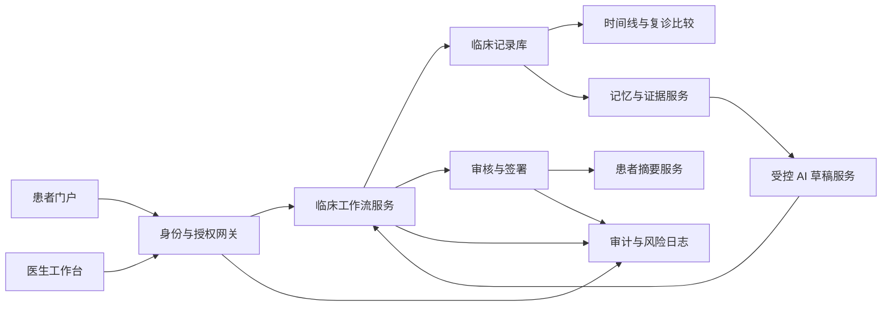

# MAP-006｜Alpha 系统架构

## 模块图

## 核心约束

- AI 草稿服务没有直接签署、开方、分享或修改权限。
- 工作流服务以状态机约束记录从草稿到签署的路径。
- 临床记录库保存结构化字段与附件引用；审计日志使用追加式事件。
- 记忆与证据服务按患者同意、医生空间和证据来源进行隔离检索。

## 初版数据实体

`User`、`RoleAssignment`、`Patient`、`Consent`、`CareRelationship`、`Encounter`、`Observation`、`ClinicalAssessment`、`TreatmentPlan`、`FollowUp`、`Document`、`EvidenceSource`、`AiDraft`、`AuditEvent`。

## 安全基线

传输和静态加密、身份认证、会话超时、基于角色与照护关系的访问控制、敏感操作二次确认、审计告警和最小化日志。部署合规性、保留期限和地区性要求须在真实临床试点前单独评估。
