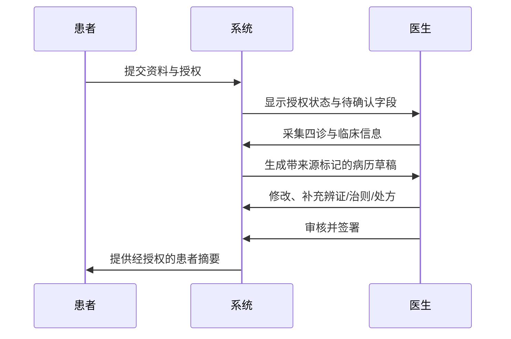

# MAP-007｜医生—患者临床工作流

## 初诊

## 复诊与随访

1. 患者在授权范围内提交症状、用药执行和不适变化；系统不作诊疗结论。
2. 系统把本次信息与上次已签署记录并列，标注新增、改善、加重、未知和待确认项。
3. 医生复核差异，记录疗效、不良反应、辨证调整与处方变更理由。
4. 医生签署后，系统更新患者时间线和可见摘要。

## 异常路径

- 无有效同意：禁止创建或读取非必要临床内容。
- AI 输出涉及诊断/处方建议：拦截为待审核草稿并提示医生。
- 患者报告紧急症状：展示预设的就医/急救提示，不由系统进行分诊结论；同时通知既定的人工流程。
- 发现记录错误：创建修订版本和原因，不覆盖历史签署版本。

## 试点验收指标

每个去标识化病例记录：完成记录耗时、医生编辑率、关键字段缺失率、医生对忠实度评分、患者摘要可读性反馈及安全事件。连续收集后再决定扩大范围。
