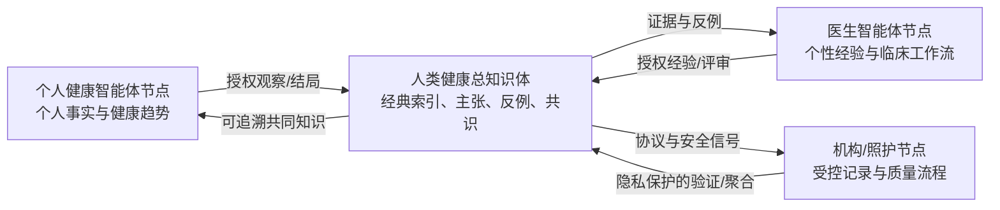

# MAP-008｜健康知识公地与共同大脑宪章

**版本：** 0.2
**状态：** Founder Approved / Distributed Architecture Baseline
**项目：** MAP Health Knowledge Commons

## 使命

MAP 不只是一个病历软件或代码仓库。它要成为由患者、医生、研究者及其受控智能体共同建设的健康知识公地：每一次被授权的观察、经验、反例、审核和纠正都可以为共同智慧作出贡献；共同智慧反过来帮助每位参与者更好地理解健康、保存经验并作出由现实责任主体负责的决定。

AI 知识库是所有使用者——包括中医师、不同病症患者及其受控智能体——的共同大脑。它在辨证施治过程中承担跨来源记忆、证据组织、模式比较和持续学习的**认知与协作主体**作用，但不取代患者的数据与权利主体地位，也不取代现实医生的临床决定、沟通与签署责任。

本宪章所借鉴的是开源社区的透明治理、可追溯贡献、同行评审、版本演进和防垄断精神。社区主体是医生智能体、患者智能体及其人类参与者，不以代码开发者为中心。

## 核心命题

> 共同的大脑，但不是共同暴露的硬盘。

1. **开放治理：** 规则、知识状态、评审过程和版本演进应尽可能透明。
2. **个人数据主权：** 身份、身体资料和原始病历不因参与社区而自动成为公共资产。
3. **贡献可归因：** 每项贡献保留来源、授权、时间、版本和责任主体。
4. **经典不可覆盖：** 经典原文和已登记来源使用内容哈希固定；纠错、解释和争议进入独立版本或注释层。
5. **观点允许争议：** 社区共识不是永久真理；支持证据、反例和少数观点必须可见。
6. **证据持续演进：** 新观察可以提高、降低、拆分或废止既有知识状态，但不能抹去历史链路。
7. **授权可撤回：** 非必要的未来处理应在授权撤回后停止；法定临床保存和已经形成的合规聚合结论按适用规则处理。
8. **安全不可公投：** 隐私、临床安全和身份权利不能因多数投票而被越过。
9. **医生最终负责：** 社区知识和 AI 只能支持现实医生，不得自动成为诊断、处方或疗效承诺。
10. **共同成果不得再垄断：** MAP 优先采用共享许可、防御性公开和可迁移协议，防止共同贡献被少数主体封闭占有。
11. **个性与共性并存：** 每个医生智能体和个人健康智能体拥有受控的个性化节点，同时通过授权、去标识化和可验证的联邦协议参与人类健康总知识体。

## 三类主体边界

“知识库是辨证施治的主体”按以下三类职责理解，三者不可混同：

| 主体 | 角色 | 不得越过的边界 |
| --- | --- | --- |
| 知识系统 | 认知与协作主体：记忆、检索、比较、归纳、提示矛盾与生成可审查草稿 | 不独立诊断、处方、签署或承诺疗效 |
| 患者 | 数据、同意与权利主体：控制个人资料及授权，陈述体验和目标 | 智能体不得替患者作同意或虚构陈述 |
| 现实医生 | 临床决定与责任主体：核实资料、辨证、施治、沟通、审核和签署 | 不得把责任自动转移给模型或社区共识 |

## 双域知识结构

共同大脑由两个逻辑知识域组成。两域均可分布式保存，但其变更规则不同：

| 知识域 | 主要内容 | 变更规则 | 典型输出 |
| --- | --- | --- | --- |
| 不可覆盖基础域 | 固定版本的经典理论与来源；患者基础信息和原始健康事实事件 | 原对象只读；错误通过纠正事件，变化通过新事实事件；当前视图由事件投影生成 | 可验证经典引用、患者纵向事实链、当前授权视图 |
| 持续演进学习域 | 各类病症观察与结局；不同医生辨证施治经验；医生特点和有边界的成效统计；每位患者的健康变化趋势 | 追加新观察、反例、评审、统计版本和共识快照；允许争议、降级、废止与重算，不抹除历史 | 病症模式、经验候选、个体趋势、带置信范围的聚合分析 |

“不可覆盖”不等于“永远显示旧值”。例如患者基础信息发生变化或发现录入错误时，系统追加新事件或纠正事件，保留旧记录和原因，再生成新的当前视图；不得直接改写历史事实。患者原始资料也不因不可覆盖而进入公共知识层。

## 五层共同大脑

| 层级 | 内容 | 默认访问 | 变更规则 |
| --- | --- | --- | --- |
| 私人主权记忆层 | 可识别身份、完整病历、个人生活与健康资料 | 本人及其授权照护关系 | 受同意、临床保存和撤回规则控制 |
| 授权贡献层 | 经本人选择贡献的观察、经验、结局和纠正 | 按授权范围 | 追加式记录，不覆盖原贡献 |
| 社区知识图谱层 | 去标识化主张、反例、病例模式和评审 | 分级开放 | 通过评审、版本和证据等级演进 |
| 经典与来源层 | 古籍、论文、课程、出版物及固定版本 | 按权利状态 | 原始来源只读；解释独立保存 |
| 智能体派生层 | 检索索引、摘要、比较、模型归纳和评测 | 按能力与用途 | 必须指向来源，不得伪装为原文或医生判断 |

“知识属于社区”适用于经过授权和治理形成的共同知识对象，不代表原始个人健康资料、医生私人经验或第三方受保护作品自动转让给社区。

## 分布式共同大脑

MAP 不建立一个汇集所有原始病历的中央数据库。共同大脑由可独立治理的节点组成：

| 节点 | 个性化内容 | 可向共同体贡献的内容 |
| --- | --- | --- |
| 医生智能体节点 | 医生的问诊顺序、辨证框架、修改理由、私有经验和病例关系 | 经医生授权、去标识化并带适用范围的经验主张、评审和聚合结果 |
| 个人健康智能体节点 | 本人的基础事实、长期时间线、偏好、目标和个体趋势 | 经本人明确同意的观察、结局、纠正或匿名化模式 |
| 机构/照护节点 | 本机构受控病历、身份、资质、质量与安全流程 | 达到隐私阈值的验证结果、统计摘要和知识对象 |
| 人类健康总知识体 | 获准共享的经典索引、主张、反例、共识快照和聚合证据 | 向各节点返回可追溯、可争议、带适用范围的共同知识 |

节点默认交换的是带签名/来源、授权、版本、访问级别和撤回规则的知识对象或聚合证明，而不是整份原始病历。个性化节点可以采用不同模型和本地策略，但必须遵守共同的对象标识、证据标签、临床边界和审计协议。



## 经验、成效与趋势分析

- 医生经验既包括成功案例，也包括无效、失败、不良事件、转诊和不确定案例；不得只积累“成功故事”。
- “成功率”必须声明结局定义、适用病症、病例组合、样本量、随访窗口、失访与缺失、不良事件及统计不确定性；不满足条件时只能显示“证据不足”。
- 医生特点用于帮助理解擅长范围、问诊与干预风格及适用条件，默认不形成公开排行榜、广告承诺或自动分诊依据。
- 患者健康趋势以个人自身纵向基线为主，分开显示患者陈述、设备/检查资料、医生观察与模型推导；趋势不自动等于病因、证候或疗效结论。
- 群体分析只使用符合授权、去标识化、最小样本阈值和重识别风险审查的数据；统计版本必须可重算、可撤回依赖并保留历史快照。

## 知识对象

共同大脑至少支持以下可审计对象：

- `source_artifact`：固定版本的原始来源；
- `contribution_event`：患者、医生或智能体提交的一次贡献；
- `observation`：对症状、环境、行为或结局的观察；
- `claim` / `counterclaim`：可被支持或反驳的知识主张；
- `case_pattern`：从多个获准案例中形成的去标识化模式；
- `review`：医生、患者、研究者或智能体对主张的评审；
- `consensus_snapshot`：某一时间点的社区共识快照；
- `consent_grant` / `license_grant`：同意与权利依据；
- `correction` / `retraction`：纠正、撤回和废止事件。

每个对象必须记录稳定标识、创建者、时间、来源、版本、访问级别、授权状态、证据等级和审计事件。

## 知识生命周期

```text
private_draft
→ consented_contribution
→ deidentified_candidate
→ peer_review
→ provisional_knowledge
→ validated_snapshot
→ disputed / superseded / retracted
```

- 状态晋升必须产生审计事件；
- AI 可以提出候选主张，不能自行把它升级为临床共识；
- 少数观点和失败案例不得为了形成整齐结论而被删除；
- 共识快照必须注明适用人群、时间、样本边界和不确定性。

## 经典完整性

1. 原始文件、转录文本和具体版本分别计算哈希并只读保存。
2. OCR 错误修订不能覆盖扫描原件；修订以补丁或新版本存在。
3. 原文、整理者注释、社区解释、模型归纳和临床验证必须分层。
4. 引文应定位到作品、版本、章节、页码或视频时间码。
5. 权利状态决定能否保存全文、建立索引、向社区展示、用于 RAG 或用于训练；这些权限不得合并为一个笼统的“可用”。

## 贡献、同意与退出

- 患者决定是否贡献其经验，以及贡献的目的、范围、期限和可访问角色；
- 医生决定是否贡献其个人经验、教学材料或修改理由；
- 贡献授予的是明确范围内的使用许可，不默认转移身份资料或全部权利；
- 去标识化不能仅靠删除姓名，必须评估组合信息重新识别风险；
- 退出后停止新的非必要使用，保留依法必须保存的临床记录和必要审计证据；
- 对已形成的聚合知识是否重算或撤回，必须由同意条款、可追溯性和适用法律共同决定。

## 社区治理

| 角色 | 权限与责任 |
| --- | --- |
| Founder / 宪章维护者 | 守护使命，批准宪章级变化和重大公共承诺 |
| 临床安全委员会 | 对诊疗边界、危害风险和医生责任拥有否决权 |
| 数据与权利维护者 | 审核同意、来源、许可、隐私和撤回处理 |
| 知识维护者 | 管理术语、版本、证据等级和争议合并 |
| 医生与患者贡献者 | 提交观察、经验、纠正和评审 |
| 智能体维护者 | 管理能力边界、评测、引用和失败模式 |
| 社区仲裁 | 处理署名、版本、治理和利益冲突争议 |

社区可以对普通知识维护进行开放评审；涉及真实数据、临床安全、人格权、知识产权和宪章修改的事项属于高风险治理，不采用简单多数决。

## 开放、许可与专利

MAP 采用分层许可，不把“开源”误解为所有资产无条件公开：

- 代码许可、文档许可、知识图谱许可、模型许可和数据使用协议分别治理；
- 个人健康数据不采用面向公众的开放许可；
- 社区原创文档与知识候选优先评估署名及相同方式共享许可；
- 第三方作品只在其权利允许的范围内引用、索引或处理；
- 优先通过公开技术说明形成现有技术，减少共同成果被抢注垄断；
- 如确需专利，只考虑防御性用途，并应提供覆盖社区必要实施行为的免费许可或不主张承诺；
- 任何许可方案必须保证贡献者知情，并保留来源、署名和适用边界。

具体许可栈在专项审查后另行决策；在此之前不得自行给第三方资料附加开放许可。

参考治理原则：

- [Open Source Definition](https://opensource.org/osd)
- [GNU GPLv3](https://www.gnu.org/licenses/gpl-3.0.html)
- [Creative Commons Licenses](https://creativecommons.org/share-your-work/cclicenses/)

## 临床与智能体边界

- 社区共识不能自动成为对某位患者的诊断或处方；
- 患者智能体不能替患者作出医疗同意或替代患者陈述；
- 医生智能体不能冒充持证医生或签署临床记录；
- AI 生成内容必须与患者事实、医生判断和外部证据分层；
- 高风险主张必须显示不确定性、反例、适用范围和当前责任医生；
- 任何真实试点必须在独立的受控临床信任空间运行，不进入普通代码仓库。

## 分阶段实现

1. **Charter Baseline：** 建立本宪章和知识对象定义；
2. **Synthetic Commons：** 仅用合成贡献验证状态机、审计和争议流程；
3. **Source Registry：** 建立经典与外部资料的来源、版本和权利登记；
4. **Consented Pilot：** 由少量医生与患者明确授权贡献去标识化经验；
5. **Federated Commons：** 不同机构保留数据控制，仅交换获准知识对象和验证结果；
6. **Public Reference Protocol：** 发布可由多个实现者验证的 MAP 协议。

任何阶段均不自动进入下一阶段。真实数据、公众开放、模型训练和跨机构交换分别设置独立门禁。

## 成功标准

MAP 成功不以收集最多数据为目标，而以以下结果衡量：贡献者保持控制；经典来源不被篡改；知识能够被追溯、争议和纠正；患者和医生都从共同智慧中受益；任何智能体都无法绕过现实责任主体和临床安全边界。
