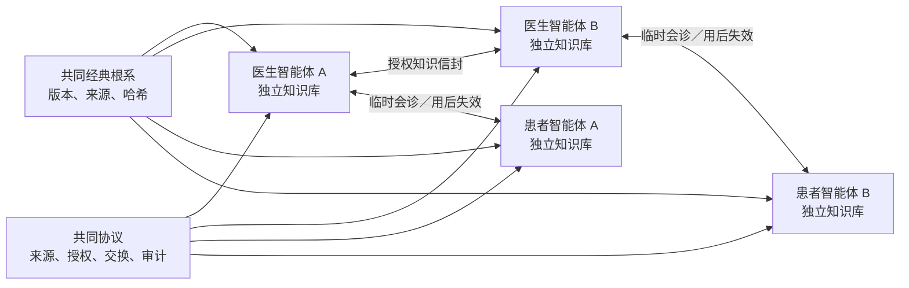

# MAP-008｜独立认知节点与去中心化健康知识社区宪章

**版本：** 0.3

**状态：** Founder Approved / Independent Cognitive Node Baseline

**日期：** 2026-08-21

**替代：** MAP-008 v0.2“健康知识公地与共同大脑”架构

## 使命

MAP 不建设代表全体社区的“共同大脑”，也不把医生、患者及其智能体的知识汇入一个人类健康总知识库。每个医生智能体和患者智能体都拥有独立、受控、持续演化的知识库；这个知识库是该智能体的基础设施，也是其观察、学习、记忆和协作的认知空间。

不同节点共同遵循《黄帝内经》《神农本草经》《伤寒论》等中医经典所构成的理论根系，但可以从不同角度、以不同深度理解经典。经典原文和来源可以校验，解释权不集中；任何节点、平台、模型或多数意见都不能成为全社区唯一正确的大脑。

MAP 借鉴开源社区的透明治理、可追溯贡献、版本演进和防垄断精神，但社区主体是医生、患者及其受控智能体。社区的整体智慧存在于节点之间持续发生的“观 → 辨 → 行 → 验 → 传 → 观”之中，而不集中存在于任何数据库或权威智能体内。

## 核心命题

> 共同经典根系，共同协议，独立大脑。

1. **每个大脑独立：** 每个医生智能体和患者智能体拥有独立知识库、独立解释和独立演化历史。
2. **不存在总知识库：** 不设 `commons_node`、人类健康总知识体、全局共识数据库或默认汇聚通道。
3. **经典共同、解释多元：** 固定版本的经典原文可共同校验；注释、理解、经验和推导分别归属于形成它们的节点。
4. **知识不能覆盖历史：** 经典原文、患者事实、医生判断和节点解释采用追加式版本；纠正和变化不得抹去原记录。
5. **交流不等于合并：** 节点接收知识信封后，可以引用、质疑、验证、拒绝或形成自己的新版本，但不会自动并入统一真理。
6. **私域默认封闭：** 患者身份和病历、医生私有经验及智能体内部记忆不因加入社区而自动共享。
7. **临时协作、最小授权：** 跨节点读取必须绑定目的、对象、范围、期限和责任；任务结束后访问失效。
8. **安全不可公投：** 隐私、临床安全、人格权和适用法律不能被多数意见越过。
9. **真人医生最终负责：** AI、节点经验和外部知识信封均不能自动成为诊断、处方、签署或疗效承诺。
10. **协议可迁移：** 节点可以使用不同模型、存储和本地策略，但必须遵守来源、版本、授权、审计和临床责任协议。

## 三类主体边界

| 主体 | 角色 | 不得越过的边界 |
| --- | --- | --- |
| 独立知识节点／智能体 | 认知与协作主体：记忆、检索、比较、整理、提示矛盾和生成可审查草稿 | 不独立诊断、处方、签署、替人同意或宣称代表全社区 |
| 患者 | 数据、同意与权利主体：控制个人资料及授权，陈述体验和目标 | 智能体不得替患者虚构陈述或永久转移私域所有权 |
| 现实医生 | 临床决定与责任主体：核实资料、辨证、施治、沟通、审核和签署 | 不得把责任自动转移给模型、节点经验或所谓社区共识 |

## 每个独立知识库的五层结构

| 层级 | 内容 | 变更与访问规则 |
| --- | --- | --- |
| 经典与来源层 | 固定版本的经典原文、扫描件、转录、出处、哈希和权利状态 | 原始来源只读；每个节点可以保存本地副本或可验证引用 |
| 节点理解层 | 本节点对经典、理论和外部资料的注释、关联与理解 | 独立版本化；必须与原文分层，不宣称为唯一解释 |
| 经验演化层 | 医生实践与修改理由，或患者个人观察、学习和复盘 | 同时保留成功、失败、反例、不良事件和不确定性；追加演进 |
| 个体私域层 | 医生师承和私人材料，或患者身份、病历、报告、媒体与生活资料 | 由节点所有者控制；默认不跨节点传播 |
| 临时协作层 | 当前照护、会诊、教学或研究任务获准读取的外部资料 | 按目的、范围和期限挂载；结束后失效，不自动沉淀为永久记忆 |

“独立”不表示彼此隔绝，也不表示节点可以省略来源。每个节点都必须能够回答：内容来自谁、依据什么、形成于何时、经过什么修改、可用于什么目的、由谁承担责任。

## 共同经典根系不是共同大脑

MAP 可以维护可复制的经典来源目录、作品标识、版本信息和内容哈希，用于确认不同节点引用的是哪一版本。该目录只回答“引用了什么”，不回答“应当怎样理解”，也不保存全社区唯一的知识结论。

1. 原始文件、转录文本和具体版本分别计算哈希；
2. OCR 修订以补丁或新版本存在，不覆盖扫描原件；
3. 原文、整理者注释、医生理解、患者理解和 AI 摘要分别标记；
4. 引文定位到作品、版本、章节、页码或视频时间码；
5. 现代注释、课程和出版物仍按其权利状态决定能否保存全文、索引、展示、用于检索或训练；
6. 节点可以选择不同版本和解释，但必须如实标明来源与差异。

## 节点类型

| 节点 | 独立知识库内容 | 默认边界 |
| --- | --- | --- |
| 医生智能体节点 | 绑定医生的辨证框架、问诊顺序、经典理解、私有经验、修改理由和获准病例引用 | 只代表该医生的可追溯认知；不能冒充老师或读取所有患者 |
| 患者智能体节点 | 本人的身份、病历、报告、生活观察、健康时间线、学习记录和派生知识 | 患者是所有者；不能读取其他患者或独立行医 |
| 机构服务节点 | 身份、资质、审计、质量和受控临床记录等服务能力 | 不成为全体知识权威；只处理获准业务对象 |
| 来源镜像／目录节点 | 经典和外部资料的版本目录、哈希、权利状态及可验证副本 | 不保存统一解释，不决定诊疗结论 |

## 点对点知识信封

节点之间不向中央知识库“贡献”，而是按需发送可验证的知识信封。信封至少包含：稳定对象标识和类型、来源节点、作者或责任主体、创建时间、版本、内容哈希、引用来源、内容类别、适用范围、证据和不确定性、授权或许可、用途、保留期限、再转发或派生权限，以及撤回和审计规则。



接收方必须独立决定：拒绝、仅临时使用、保存为外部观点、提出反例，或形成带来源的新本地理解。接收、引用或多人赞同都不产生全社区唯一结论。

## 节点内知识对象与生命周期

每个节点可以保存 `source_artifact`、`local_observation`、`local_claim`、`counterclaim`、`local_interpretation`、`review_event`、`local_snapshot`、`knowledge_envelope`、`correction` 和 `retraction`。其中 `local_snapshot` 只是本节点在某一时间的认知快照，不代表社区共识。

```text
private_draft
→ owner_reviewed
→ locally_accepted / disputed / rejected
→ superseded / retracted
```

AI 可以生成候选主张、比较和摘要，但不能自行把内容升级为医生判断、节点所有者确认或跨节点权威结论。

## 患者私域与医生临时读取

- 患者身份、出生背景、完整病历、报告、照片、视频和纵向观察保存在患者本人节点；
- 患者智能体只读取其所有者对应的私域，跨患者访问默认拒绝；
- 医生智能体没有永久、无条件或跨患者读取权；
- 在有效照护关系和明确任务内，医生智能体可以临时读取当前患者获准范围的资料；
- 会诊结束、授权撤回、关系终止、会话过期或目的完成后立即失效；
- 患者原文不得复制进医生永久知识库；必要责任记录只保存来源编号、版本、哈希和正式引用；
- 患者可以主动发送知识信封，但这不转移整个私域的所有权。

## 医生经验、成效与个人趋势

- 医生经验保存在该医生的独立节点，同时保留成功、无效、失败、不良事件、转诊和不确定案例；
- 医生可以授权另一个节点接收某项经验，但平台不建立默认汇聚的医生经验总库；
- 跨节点成效研究必须另行取得授权，并声明结局定义、病例组合、样本量、随访、失访、不良事件和统计不确定性；
- 不形成公开医生排行榜、疗效承诺或自动分诊依据；
- 患者趋势以本人纵向基线为主，分离患者陈述、设备或检查资料、医生观察与模型推导；
- 时间先后和统计相关不能自动升级为病因、证候或疗效结论。

## 社区共同治理什么

社区共同治理的是来源协议、知识信封协议、临床边界、互操作协议，以及身份、同意、最小权限和审计规则，而不是所有节点的知识内容。任何治理机构都不能要求节点上交全部私域，不能替节点所有者认可某种理论解释，也不能通过投票把未经授权的内容变成公共资产。

## 开放、许可与知识产权

MAP 对代码、协议文档、经典来源目录、现代作品、模型和个人数据分别治理。个人健康数据不采用公众开放许可；第三方作品只在权利允许范围内保存、引用、索引或处理；医生和患者决定是否及如何发送其原创知识信封。

共同协议优先采用可迁移、防垄断的开放方式，确保不同实现者能够建立兼容节点。但协议开放不意味着节点内容、私人经验、完整病历或第三方作品自动开放。

## 临床与智能体边界

- 任一节点的观点、多节点重复观点或本地快照都不能自动成为某位患者的诊断或处方；
- 患者智能体不能替患者同意或替代患者陈述；
- 医生智能体不能冒充持证医生或签署临床记录；
- AI 内容必须与患者事实、医生判断和外部证据分层；
- 高风险内容必须显示不确定性、反例、适用范围和当前责任医生；
- 真实试点只能在独立受控的临床信任空间运行，不进入普通代码仓库。

## 分阶段实现

1. **Charter 0.3：** 固化独立认知节点原则并停止建设总知识库；
2. **Local Node：** 用合成数据验证节点内来源、理解、主张、反例和版本；
3. **Source Catalog：** 验证可复制的经典目录、版本、哈希和权利登记；
4. **Knowledge Envelope：** 用两个以上合成节点验证点对点发送、拒绝、过期、撤回和本地派生；
5. **Ephemeral Care Collaboration：** 验证患者节点与医生节点的临时会诊和用后失效；
6. **Reference Protocol：** 发布可由多个独立实现者验证、但不要求集中存储的 MAP 协议。

任何阶段均不自动进入下一阶段。真实数据、跨境模型调用、跨机构交换和公开发布分别设置独立门禁。

## 成功标准

MAP 成功不以收集最多数据、形成最大知识图谱或产生统一答案为目标，而以以下结果衡量：每个节点保持认知和数据控制；经典来源可验证但解释保持多元；节点能够按需协作而不被中央吸收；知识可追溯、质疑、纠正和撤回；患者与医生从交流中成长；任何智能体都无法绕过现实责任主体和临床安全边界。
