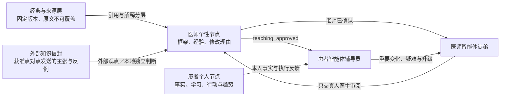

# MAP-AI-001｜医师徒弟与患者辅导智能体架构 0.1

- 状态：Synthetic Engineering Candidate
- 日期：2026-08-13
- 临床状态：不用于真实诊疗

## 产品目标

首个产品不是一个统一口径的“中医大模型”，而是为每位中医师配置一个专属智能体徒弟，并为每位患者配置一个个人健康辅导员。

医师智能体学习老师独特且持续演进的辨证框架，把望闻问切、空间位置、状态关系、时间趋势、正邪盛衰、排除证据和经典联系整理成供老师审阅的动态人体图。患者智能体负责课后辅导，把医生已确认的生活教导转为日常可执行、可观察、可复盘的成长任务。它的目标是减少患者对真人医生处理普通问题的依赖，而不是增加平台黏性。

## 两个角色，不是两个自主医生

| 角色 | 能做 | 不能做 | 成功标准 |
|---|---|---|---|
| 医师智能体徒弟 | 检索老师知识、整理人体状态图、列证据/反证/未知、保存修改理由 | 独立诊断、辨证定论、处方、签署、冒充老师 | 越来越忠实地呈现该老师的思维，并减少机械整理时间 |
| 患者智能体辅导员 | 解释已确认教导、行动拆解、观察提醒、复述确认、趋势复盘 | 诊断、开方、改药、替患者同意、制造依赖 | 患者逐步理解并执行适合自己的健康知识，普通问题减少回流医生 |

每一次运行只选择一个角色。0.1 不设置能够同时读取全部医师私域与患者私域的中央路由智能体。

## 个性知识节点

医师节点可以保存私有经验、祖传内容、自创框架和来源不明的个人材料，但必须标记来源与权利状态；`unknown` 不能伪装为经典原文。患者辅导员只能读取当前患者节点、医生明确批准的 `teaching_approved` 内容，以及发送给该节点的获准外部知识信封，不能读取老师全部私域。项目不设共同知识体；每个节点独立决定是否接受、质疑或拒绝外部观点。

患者的个人信息、病历、报告、影像、日常观察和健康变化不属于这张“教学知识条目表”的附属信息，而属于患者本人拥有的完整健康私域。其来源事实、健康时间线和 AI 派生知识采用独立结构，详见 [MAP-AI-002 患者健康私域与个人知识库](MAP-AI-002-patient-private-vault-v0.1.md)。患者辅导员可检索与其所有者相同的合成患者私域；医师徒弟没有永久或默认患者权限，但可通过 [MAP-AI-003 临时会诊空间](MAP-AI-003-physician-ephemeral-consultation-v0.1.md) 读取当前照护任务中的当前患者。

## 知识演进

经典原文使用固定版本与哈希；注释、医师理解和 AI 摘要分层保存。医师框架采用追加式版本：新版本指向 `supersedes_id`，旧版本标记为 superseded，但不删除。只有绑定真人老师可以把医师框架从 `candidate` 确认为 `teacher_confirmed`。

AI 输出始终保存在 `agent_run_drafts`，状态固定为 `ai_draft`、`clinical_authority=0`。AI 草稿不会自动进入医师知识库，更不会成为临床签署记录。

不同智能体只通过 MAP-008 v0.3 定义的点对点知识信封交流。信封必须保留来源节点、版本、授权、适用范围和保留期限；接收不等于认可，也不能形成全社区唯一解释。

## 首轮运行方式

0.1 采用 OpenAI Agents SDK 的单一专门智能体路径：服务端根据当前角色创建一个职责清晰的 Agent，只暴露当前节点的只读知识检索工具。SDK 负责模型循环；身份、存储、知识授权、审计和未来的人类批准由 MAP 应用负责。

当前不采用 SandboxAgent。知识检索只是数据库只读工具，不需要让模型操作文件、执行命令或安装软件；控制平面和数据访问留在可信应用中。若未来需要让智能体在隔离工作区整理大量获准文档，再单独引入 Sandbox，并保持认证、授权、审计和审批在沙箱之外。

## Gate 0 验收

1. 每位医师徒弟只绑定一位合成老师；
2. 医师知识可追加新版本且旧版本可追溯；
3. 患者辅导员无法检索 `private` 与 `care_relationship` 医师知识；
4. 原文层权利不明时拒绝写入；
5. AI 草稿始终无临床权限；
6. 所有写入形成审计事件；
7. 所有工程演示只使用 `SYN-` 合成编号。
8. 患者身份、病历和媒体引用进入患者私域来源层，不与 AI 摘要混存；跨患者检索拒绝。
9. 医师徒弟只有在绑定医生、患者、照护关系、目的、范围和时限全部有效的临时会诊空间中读取患者资料；关闭后拒绝继续读取。

## 后续真人批准

- 真人技术合伙人：审查节点隔离、密钥管理、服务端身份和部署边界；
- 真人中医师：确认其自身框架的表达、版本和可供患者教学的范围；
- 患者／市场合伙人：审查辅导方式是否真正帮助成长，而非形成新的数字依赖；
- 法律与隐私负责人：确定真实环境的告知、授权、保存和跨境模型调用方式。
