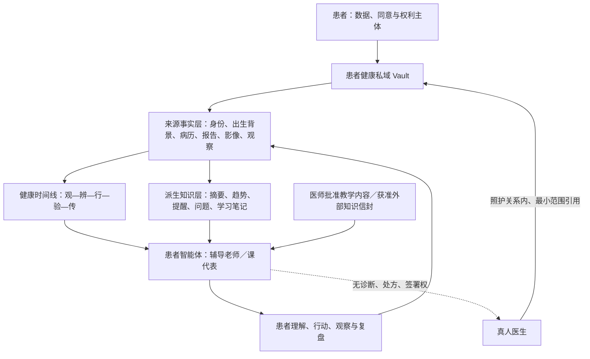

# MAP-AI-002｜患者健康私域与个人知识库 0.1

状态：`Synthetic Runtime Candidate / Not Production Ready`

日期：2026-08-13

## 修正的定义

患者知识库不是只供智能体检索的健康文章集合，也不是病历系统之外的一组聊天记忆。它是患者拥有和控制的完整个人健康私域，至少保存患者身份与先天背景、原始健康档案、纵向健康变化，以及在这些来源上形成的可复核派生知识。

患者智能体是这个私域的受控使用者和辅导者，不是私域所有者，也不是独立医生。

## 一、来源事实层

患者私域至少能够保存：

- 身份资料：真实姓名、性别或性别记录、出生具体时间和地点、居住史与必要的家庭关系背景；
- 先天与家族背景：家族健康史、成长环境和长期地域气候背景；
- 原始健康档案：历次病历、体检与检验检查报告、处方、用药、过敏、手术或其他处置记录；
- 多媒体资料：患处照片、视频、音频和其他健康文件的受控存储引用；
- 日常观察：饮食、睡眠、二便、情绪、运动、穿衣、气候、居住环境和身体感受；
- 医生指导与真实结果：老师的生活指导、治疗建议、执行过程、疗效、不良反应和未达到预期的结果。

来源事实只追加，不原位改写。错误通过新版本纠正，旧版本仍保留；任何展示都要能够说明是谁、何时、从什么来源记录的。

## 二、健康时间线

时间线不是简单的聊天记录，而是把身份基线、就诊、观察、检查、干预、生活变化、环境变化和结果按时间组织。每个事件必须引用同一私域中的来源资料，并保留以下区别：

- 患者自己陈述；
- 真人医生确认；
- 外部报告或文件记载；
- 设备记录；
- 系统整理。

先后发生不自动等于因果关系。AI 可以提示可能相关的变化，但不能把相关性写成已经证实的病因。

## 三、派生知识层

患者智能体可以基于来源资料形成摘要、趋势、提醒、待问医生的问题和学习笔记，但必须同时保存所引用的原始资料编号。

AI 生成内容固定从 `ai_draft` 开始。患者确认表示“这符合我的陈述”，医生确认表示“医生审阅过这段派生表达”；两者都不把它自动升级为正式诊断、处方或签发病历。新总结通过追加版本替代旧总结，不能悄悄改写历史。

## 四、访问边界

- 患者智能体只可检索其节点所有者对应的患者私域；跨患者访问默认拒绝；
- 医师智能体徒弟没有永久或无条件读取权；接诊期间可通过 MAP-AI-003 临时会诊空间读取当前患者的获准整体资料，关闭后立即失效；
- 医生获得的是履责所需的引用权，不是整个患者私域的所有权；
- 原始病历和身份不会因为加入社区而进入任何共同健康知识体，因为现行架构不设置总知识库；如需与医生或其他节点协作，必须另行生成有接收者、目的、范围、期限和撤回规则的知识信封；
- 模型提供商不是当然的数据接收者。真实私域内容是否可以发送给某个模型，必须由生产环境的路由、授权与合规门禁决定。

## 五、当前实现与未解除门禁

Gate 0 已实现 SQLite 合成运行时：`patient_private_vaults`、`patient_vault_entries`、`patient_health_timeline_events` 和 `patient_derived_knowledge`，并让患者辅导智能体拥有与教学知识分开的本人私域只读检索工具。医师徒弟通过独立的临时会诊访问表读取当前患者，不把患者内容写进医生永久知识节点。

当前实现只接受 `SYN-` 患者和 `synthetic://` 来源。真实姓名、真实病历、报告、照片或视频仍禁止进入仓库与当前运行时。生产阶段必须先完成服务端身份与对象授权、加密对象存储、KMS、备份恢复、保留与删除政策、模型供应商数据路由，以及真人技术、法律隐私和临床批准。
