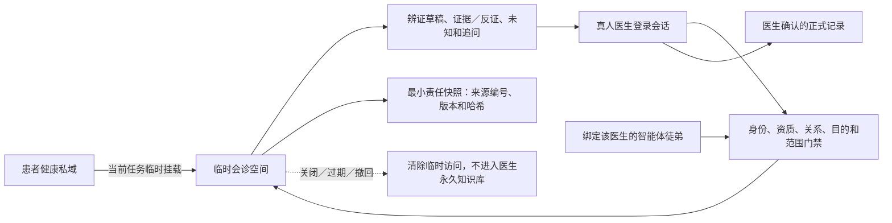

# MAP-AI-003｜医师智能体临时会诊空间 0.1

状态：`Synthetic Runtime Candidate / Not Production Ready`

日期：2026-08-13

## 修正后的原则

医师智能体要协助真人医生辨证，就必须能够读取当前患者的整体资料。“医师徒弟默认无患者私域权限”不是永远不读，而是没有永久占有权、没有跨患者浏览权，也不能在没有当前照护任务时读取。

当前真人医生、绑定该医生的智能体徒弟、当前患者和当前照护任务共同形成一个有时间限制的临时会诊空间。患者资料在会诊期间按获准范围挂载，会话结束后撤销；患者原文不写入医生永久知识库。

## 打开条件

临时会诊必须同时满足：

1. 服务端识别出当前登录主体是资质有效的真人医生；
2. 当前医师智能体只绑定该医生；
3. 医生和选定患者之间存在有效照护关系；
4. 系统授权依据覆盖当前目的和资料类别；
5. 选定私域确实属于当前患者；
6. 会诊有效期不超过医生登录会话，Gate 0 最长四小时。

这里的系统授权可以在符合产品与适用规则的流程中自动形成或由患者管理，不要求医生在接诊现场反复填写格式化表单；但系统内部必须有可验证的授权事实源，不能因为医生或智能体知道患者编号就开放资料。

## 会诊期间

中医整体辨证所需范围可以较宽，包括身份与出生背景、居住环境、生活习惯、完整病史、检查报告、历次治疗、照片视频、患者观察、医生指导和结果。范围由当前照护任务决定，不等于平台上所有患者都可浏览。

每一次读取都重新检查医生登录、照护关系、授权依据和临时空间是否仍有效。读取结果只进入当前模型上下文和医生界面；检索词与患者原文不写入访问表或审计日志。医师智能体输出仍是无临床权限草稿。

## 关闭和最小保留

会诊关闭、过期、医生会话撤销、照护关系结束或授权撤回后，后续读取立即拒绝。系统不把患者原始资料复制进医生永久知识库，也不保留临时患者内容副本。

为支持复诊连续性与责任审查，系统可以保留最小责任快照：医生及智能体身份、访问时间与目的、所依据资料的编号/类别/版本/内容哈希、AI草稿引用和最终正式记录引用。快照不保存患者原文、照片或报告副本。

## 尚未解除的生产门禁

Gate 0 只验证合成数据状态机。真实患者资料上线前仍需实现加密临时工作区、服务端对象授权、模型供应商不训练与留存控制、缓存/日志/追踪清理、责任快照保留政策，以及真人技术、临床、法律和隐私批准。
