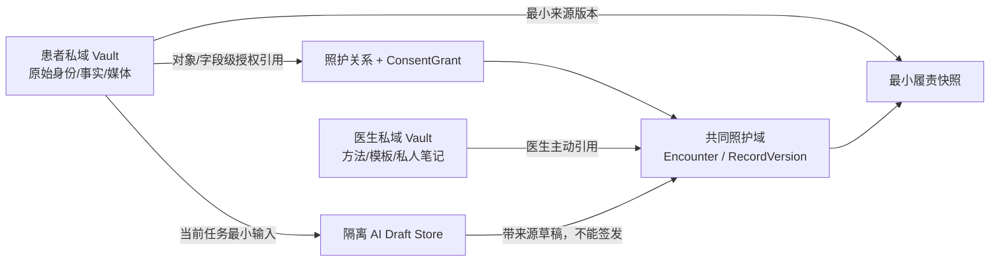
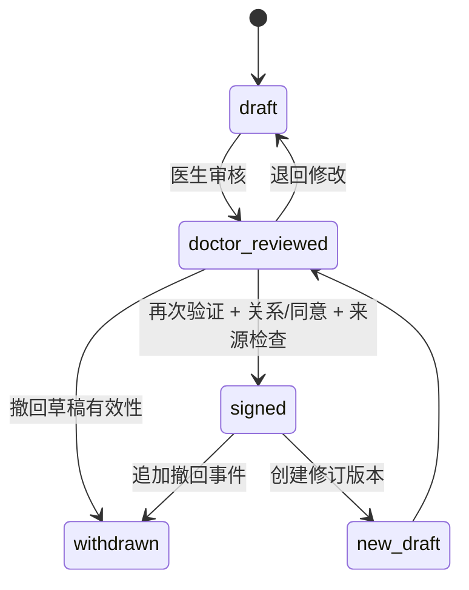

# MAP-DEV-003｜临床数据 Schema V0.1

- 版本：0.1.0
- 状态：Gate 0 Engineering Candidate / Doctor Review Pending
- 日期：2026-08-10
- 适用范围：TCM Copilot V8.0 Alpha 合成环境
- 机器合同：[`schemas/gate0/clinical-schema-v0.1.json`](../../schemas/gate0/clinical-schema-v0.1.json)
- 临床字段注册表：[`schemas/tcm_clinical_fields_v0.1.json`](../../schemas/tcm_clinical_fields_v0.1.json)

## 1. 结论

本 Schema 在不破坏现有 SQLite 合成原型的前提下，为 Gate 1 建立临床对象、患者/医生 Vault、照护关系授权、字段来源、AI 草稿隔离、签发版本和审计的统一工程合同。

本版本不是生产数据库 DDL，也不解除真实数据 Gate。仓库、测试、评审和当前运行时继续只允许 `SYN-` 合成标识；字段字典仍等待真人医生评审，机器校验通过不等于临床确认。

## 2. 设计目标

1. 兼容现有 `patients / consents / encounters / observations / assessments / audit_events`；
2. 保持 `draft → doctor_reviewed → signed` 和追加式 `withdrawn` 状态机；
3. 让每个字段都能表达来源、作者、时间、未知、版本和审核状态；
4. 把患者事实、医生观察、医生判断、外部证据和 AI 草稿永久分层；
5. 把患者私域与医生私域建模为不同 Vault，授权引用不等于复制所有权；
6. 冻结已签发记录及其最小来源清单，修订不覆盖历史；
7. 要求每个持久化写入和敏感访问决定形成审计事件；
8. 为生产身份、KMS、对象存储和 PostgreSQL 留出接口，但不在 Gate 0 虚构已实现能力。

## 3. 兼容性策略

Gate 0 采用 **additive contract**：先增加机器合同和映射，不修改当前客户端和 SQLite 表。

| 现有对象 | V0.1 语义 | Gate 0 处理 |
|---|---|---|
| `patients` | 合成 Patient Profile / Patient Vault owner projection | 保留；`display_code` 继续要求 `SYN-` |
| `consents` | 旧版粗粒度同意 | 保留；与 `security_consents` 一起映射到 `ConsentGrant` |
| `security_subjects` | 服务端身份主体 | 保留；未来成为 Vault owner 和临床 author 的事实源 |
| `care_relationships` | 医患对象关系 | 直接兼容；患者接受后才可 active |
| `security_consents` | 关系内目的/字段同意 | 直接兼容；扩权需新同意版本 |
| `encounters` | Encounter aggregate | 保留四种类型与四种状态 |
| `observations` | 患者事实或医生观察的兼容投影 | 保留；未来通过 `record_kind` 和来源锚点细化 |
| `assessments` | 医生判断兼容投影 | 只允许医生判断；AI 草稿不得写入 |
| `audit_events` | 最小追加式审计 | 保留；未来增加服务端角色、能力、目的、决定、原因码、会话和请求关联 |

任何生产迁移必须采用扩展—回填—双读核对—切换—延后收缩；本文件不批准删除列、改写已签发值或把 `actor_role` 继续用作生产授权事实。

## 4. 数据域与 Vault

### 4.1 Patient Private Vault

保存患者完整身份和原始健康资料的控制域。Gate 0 只定义 `vault_id`、owner、对象引用和授权语义；当前仓库不保存真实姓名、电话、证件、精确地址、真实影像或真实病历。

患者 Vault 中的原始事实和媒体版本不可被 AI 或医生静默改写。医生得到的是当前照护关系和同意覆盖范围内的引用，不取得整个 Vault 的永久副本。

### 4.2 Doctor Private Vault

保存医生的私有方法、祖传/自创经验、模板、教学材料和专业笔记。它可以保存医生主动创建的知识，以及签发记录所需的最小责任引用；不得无边界复制患者私域。

医生 Vault 的内容不会因为参与一次诊疗自动进入共同健康知识体，也不会自动用于其他医生的模型。

### 4.3 Care Domain

`Encounter`、临床版本、方案、执行和随访属于医患共同参与但权限受控的照护域。其可见性由关系、目的、字段/对象范围、期限、记录状态和服务端主体共同决定。

## 5. 核心对象

### 5.1 Vault

| 字段 | 含义 |
|---|---|
| `vault_id` | 不透明稳定标识 |
| `vault_type` | `patient_private` 或 `doctor_private` |
| `owner_subject_id` | 服务端身份主体 |
| `key_reference` | 未来 KMS 引用；绝不保存密钥明文 |
| `synthetic_only` | Gate 0 必须为 `true` |
| `status` | active / suspended / closed |

### 5.2 CareRelationship

绑定单一患者、单一医生、目的、数据类别和有效期。医生邀请只建立申请，患者再次验证并接受后才 active；不同医生之间相互独立。

### 5.3 ConsentGrant

同意必须包含：患者、接收方、关系、目的、字段/资料类别、可选对象清单、生效/失效时间、状态、版本和撤回。扩展范围产生新版本，不能原地扩大。

### 5.4 Encounter

一次初诊、复诊、check-in 或医生复盘的聚合根。创建时固定患者、关系、同意引用、时间和类型。医生进入审核或签发前必须绑定服务端解析出的医生主体。

### 5.5 ClinicalRecordVersion

保存某次 Encounter 的字段值清单和审核状态。`signed` 版本不可变；纠错创建新 `draft` 并通过 `supersedes_record_version_id` 指向旧版本；`withdrawn` 追加有效性事件，不删除历史。

### 5.6 SourceObject / SourceAnchor

`SourceObject` 表示不可变版本的文本、音频、视频、图片、文档、结构化表单或外部证据。`SourceAnchor` 定位到：

- 文字字符区间；
- 音频/视频时间段；
- 文档页码与 bbox；
- 图片 bbox；
- 完整对象版本。

任何带“有来源”标签的字段必须能回到对象版本和定位；派生值不得随着原件更新而悄悄改指新版本。

### 5.7 AiDraftVersion / AiReviewDecision

AI 草稿独立保存任务、输入锚点、授权引用、供应商、模型、提示版本、输出 Schema、输入/输出哈希和状态。AI 草稿没有 `doctor_reviewed` 或 `signed` 状态。

医生接受、修改或拒绝 AI 字段时：

1. 原 AI 输出保持不变；
2. 写入 `AiReviewDecision`；
3. 接受/修改的内容创建新的医生或患者录入字段值；
4. 新值保留 AI 来源链，但 `author_subject_id` 是实际确认者；
5. 不允许把 AI 身份伪装成医生作者。

### 5.8 ResponsibilitySnapshot

医生签发时冻结：签发版本、被依赖的字段值、来源对象版本、来源锚点和完整性哈希。大型视频/完整体检文档默认只保留必要版本/片段引用，不复制整个患者 Vault。保存期限、撤回后处理和争议保留仍需法务/隐私裁决。

## 6. 字段共同外壳

每个临床字段值使用统一 envelope：

| 字段 | 规则 |
|---|---|
| `field_value_id` | 不透明 ID |
| `encounter_id` / `field_id` | 绑定 Encounter 与 TCM-CLIN-001 字段注册表 |
| `record_kind` | patient_fact / doctor_observation / doctor_judgment / external_evidence / ai_draft |
| `value_or_unknown` | 类型化值或 unknown / not_collected / not_applicable / declined |
| `source_role` | patient / doctor / file / system / external / ai |
| `author_subject_id` | 服务端主体；AI 不得伪装医生 |
| `recorded_at` | RFC3339 UTC |
| `review_status` | draft / doctor_reviewed / signed / withdrawn |
| `version` / `supersedes_*` | 追加式修订链 |
| `source_anchor_ids` | 来源定位；无来源时显式 `source_pending` |
| `consent_grant_id` | 本次处理授权 |
| `integrity_hash` | 规范化内容与不可变元数据哈希 |

### 6.1 来源与事实边界

| 类型 | 可产生者 | 能否成为正式判断 |
|---|---|---|
| `patient_fact` | 患者；医生代录需保留患者来源 | 否 |
| `doctor_observation` | 医生实际观察/检查 | 否，仍与判断分开 |
| `doctor_judgment` | 经核验且有关系/同意的医生 | 可以，需审核、再次验证、签发 |
| `external_evidence` | 文件/有版本的外部资料 | 否，只是证据 |
| `ai_draft` | 受控 AI 任务 | 永远不能直接成为正式判断 |

未知和拒答不是错误状态。空白不得解释为“正常”，AI 也不得补齐未采集的舌、脉、月经、生殖、情志、二便或其他敏感字段。

## 7. 状态机与签发门禁

签发必须同时满足：

1. 服务端会话主体为 active `verified_doctor`；
2. 资质有效；
3. 与患者有 active CareRelationship；
4. ConsentGrant 覆盖目的和本次字段；
5. 当前记录状态为 `doctor_reviewed`；
6. 最近 10 分钟内完成 step-up（候选值）；
7. 医生判断字段作者为医生，AI 草稿仍隔离；
8. 必填字段使用真实值或明确未知状态；
9. 来源/版本检查通过；
10. 在同一事务或可靠 Outbox 中写入签发审计与责任快照。

## 8. 初诊与复诊字段

字段清单不在本文件重复维护，以 `schemas/tcm_clinical_fields_v0.1.json` 为唯一候选注册表。Gate 0 Schema 增加对象、来源、Vault、签发和审计外壳，但不擅自改变 47 个候选字段。

真人医生仍需确认：门诊顺序、必填程度、舌/脉粒度、危险信号、干预和疗效结构、流派专属配置。确认后通过新版本更新字段注册表，不覆盖本次候选历史。

## 9. 审计要求

所有持久化写入必须审计。至少记录：事件 ID、主体、服务端角色、能力、对象、目的、允许/拒绝或成功/失败、原因码、会话、时间、来源应用、请求 ID。

以下事件额外强制：

- Vault/资料对象创建、修订、导出、删除请求；
- 照护关系建立、接受、终止；
- 同意授予、扩展、撤回、过期；
- 临床读取、写入、审核、签发、撤回；
- AI 输入构建、供应商调用、输出、医生接受/修改/拒绝；
- ResponsibilitySnapshot 创建与验证；
- 权限拒绝、Break-glass 和管理操作。

审计不记录令牌、凭据、密钥、完整病历或非必要临床正文。

## 10. 迁移建议（未授权实施）

1. 先实现服务器会话与 `security_subjects` 到临床 actor 的映射；
2. 引入 Vault、RecordVersion、FieldValue、SourceObject/Anchor、AiDraft/Review、Snapshot；
3. 保留旧表，建立兼容投影与双写核对；
4. 回填合成数据的 `SYN-` Vault、来源和审计；
5. 运行现有测试、合同测试、负向权限和签发不可变测试；
6. 只有核对一致后才切换读路径；旧列延后处理且需单独 ADR。

## 11. Gate 0 验收

- JSON 可被标准解析器读取；
- 保留现有四状态临床状态机和实体语义；
- 明确 Patient/Doctor Vault 和授权引用边界；
- 明确字段来源与未知状态；
- AI 草稿有独立对象和禁止签发状态；
- 签发版本不可变，修订/撤回追加；
- 所有写入与敏感决定需要审计；
- 只使用合成示例；
- 不宣称生产身份、加密、备份或真实临床可用。

## 12. 待决事项

1. 真人医生对 TCM-CLIN-001 的 47 个字段及顺序确认；
2. 生产 Patient/Doctor Vault 是共享数据库逻辑隔离、独立密钥，还是进一步物理隔离；
3. 已签发记录和 ResponsibilitySnapshot 的法定/责任保留期限；
4. 撤回后医生履责快照的最小内容；
5. 浏览器媒体采集上限、转码、病毒扫描与对象存储策略；
6. PostgreSQL 目标 DDL、RLS 是否作为纵深控制以及迁移窗口；
7. 来源锚点最小粒度和 AI 草稿字段接受交互。

---

**安全声明：** 本文件及机器合同仅含合成标识和结构定义，不含真实患者数据，不批准真实临床使用。
