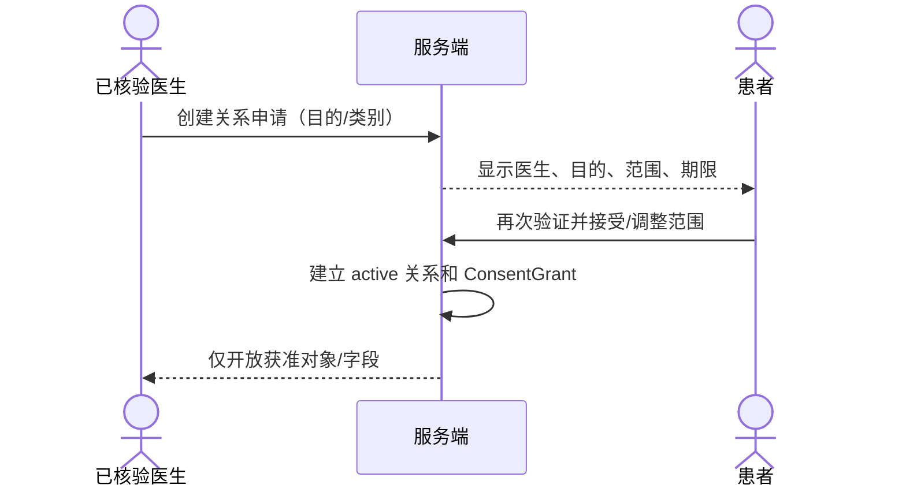
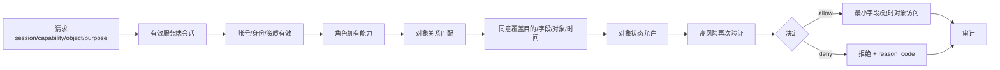

# MAP-DEV-004｜身份、同意、授权与审计详细设计 V0.1

- 版本：0.1.0
- 状态：Gate 0 Security Design Candidate / Not Production Ready
- 日期：2026-08-10
- 适用范围：合成身份、合成临床流程与后续生产设计门禁
- 上游：MAP-004、DEC-024、DEC-026、TCM-SEC-001 0.2、MAP-DEV-003

## 1. 结论

Alpha 权限事实源必须是 **服务端会话主体 + 账户/资质状态 + 对象关系 + 患者同意 + 目的/字段/对象范围 + 对象状态 + 高风险再次验证**。邀请、客户端角色字符串、AI 工具身份或管理员身份都不能单独授予临床访问或签发权。

当前 `IdentityAccessService` 已用 SQLite 和合成数据验证状态顺序，但尚未接入生产身份提供者、安全 Cookie/CSRF、生产 KMS、真实资质核验和临床 HTTP 写接口。因此 Gate 0 只固化合同和差距，不解除 `synthetic_only`。

## 2. 主体、控制域与职责

| 主体 | 控制/负责 | 默认禁止 |
|---|---|---|
| `patient` | 自身 Patient Vault、同意、关系接受、事实和反馈 | 签发医生判断；替他人同意 |
| `verified_doctor` | Doctor Vault；关系内观察、判断、审核、签发 | 跨关系浏览；复制完整 Patient Vault；委托 AI 签发 |
| `care_executor` | 当前执行任务需要的最少计划；实际执行和异常 | 制定/修改方案；查看完整病历；签发 |
| `clinic_admin` | 账号、邀请、配置、安全事件 | 默认读取临床正文 |
| `founder_operator` | 治理配置和去标识化质量 | 默认读取临床正文；临床决定 |
| `knowledge_steward` | 来源、版本、知识主张和争议 | 未授权患者私域；发布处方 |
| `delegated_agent` | 主体明确授权范围内整理、检索、起草 | 同意、接受关系、邀请、提权、签发、生产密钥 |
| service identity | 单一后台任务能力 | 交互登录、扩大数据范围、把失败静默改为允许 |

Agent 权限必须以代表谁、做什么、对哪个对象、为何、多久有效为条件；“这是 AI 助手”不是权限。

## 3. 身份与账号状态

### 3.1 独立标识

- `subject_id` 是服务端稳定、不透明且不可复用的主体标识；
- 显示名、联系方式、资质材料、临床内容和审计分层保存；
- 工程仓库只允许 `SYN-*` display code；真实标识不得进入 Git、Issue、CI、测试和日志；
- 人与 Agent 不共享主体 ID。Agent 使用独立 service/delegated identity，并带委托主体和能力范围。

### 3.2 账号状态

```text
identity_pending → active → suspended / rejected
```

医生还必须有独立 `verification_status` 和 `credential_status`。邀请已接受、账号 active 或客户端声称 doctor 均不能替代资质状态。

### 3.3 邀请

```text
issued → accepted → identity_pending → active
       ↘ expired / revoked / rejected / suspended
```

邀请必须：

- 使用高熵一次性令牌，数据库只存 SHA-256 摘要；
- 绑定预期角色、邀请者、接收通道/对象、目的、签发/失效时间和最多一次使用；
- 明文令牌只返回一次，不进入 URL 查询日志、分析、Git 或 CI；
- 接受邀请只进入身份/关系申请，不自动授予医生资质、患者同意、资料访问或签发权；
- 第二次使用、过期、错绑、撤回均拒绝并审计。

## 4. 会话

### 4.1 Web 候选基线

- `Secure + HttpOnly + SameSite` Cookie；认证令牌不进入 `localStorage`；
- 写操作使用 CSRF 防护；登录、邀请接受、签发和导出防重放；
- 候选超时：空闲 30 分钟、绝对 12 小时；生产值待真实使用评审；
- 服务端会话支持轮换和立即撤销；登出、凭据重置、账号暂停、安全事件撤销所有相关会话；
- 新设备、异常地域、连续失败和高风险操作形成告警。

### 4.2 Step-up

以下能力要求最近 10 分钟内再次验证（候选值）：

- `clinical_record.sign`
- `consent.change`
- `care_relationship.change`
- `invitation.issue`
- `bulk_export.request`
- `role_or_verification.change`
- `break_glass.request/approve`
- `production_release.approve`（工程运营域）

Step-up 结果绑定当前会话、主体、时间和认证方式；不能由客户端时间或请求体布尔值自报。

## 5. 照护关系

### 5.1 建立流程



### 5.2 规则

- 患者接受不可由医生、管理员或 AI 代理；
- 一位患者与每位医生拥有独立关系和独立同意；
- 会诊需要多个明确关系/授权，不由一位医生转授权；
- `ended/revoked/expired` 后停止新的非必要读取和处理；
- 既有签发记录/履责快照按获批保留策略处理，不因关系结束改写历史；
- 执行者由患者明确授权并由医生发布任务范围，只获得当前执行最少信息。

## 6. 同意模型

### 6.1 ConsentGrant 最小字段

| 字段 | 规则 |
|---|---|
| grantor / data subject | 患者或经核验合法代理人；Alpha 建议先仅成年人本人 |
| recipient | 具体医生或执行者，不是泛化“平台所有人” |
| relationship | 对应 active CareRelationship |
| purpose | 诊疗记录、随访、某次导出等精确目的 |
| data categories | symptoms / observations / medications / media / plan 等白名单 |
| object scope | 可选的资料包/对象 ID 白名单 |
| effective / expiry | 生效与失效时间 |
| status/version | active / revoked / expired；扩权新建版本 |
| revocation handling | 新访问立即停止；历史与快照按规则处理 |

### 6.2 同意不是所有权转移

医生获得的是在目的、范围和期限内访问患者对象的能力。Patient Vault 仍由患者控制；Doctor Vault 只保存医生私有内容和经批准的最小责任快照。系统不得把患者“加入平台”解释为向社区、模型或其他医生贡献资料。

### 6.3 撤回

撤回必须：

1. 患者高风险再次验证；
2. 追加 `consent.revoked`，保留原 grant 版本；
3. 立即拒绝新的读取、AI任务、共享和导出；
4. 尝试取消尚未发出的异步任务；已发给供应商的处理按合同/策略记录；
5. 标记受影响的缓存、派生内容和授权链接；
6. 不伪造删除历史签发或审计；
7. 按法务批准的保留与备份到期策略处理实体副本。

## 7. 授权决策



### 7.1 请求上下文

授权引擎输入必须来自可信服务端上下文：

- `session_id / subject_id / server_role`
- `capability`
- `object_type / object_id / owner_vault_id`
- `patient_subject_id / care_relationship_id`
- `purpose / data_categories / resource_object_ids`
- `object_state`
- `request_id / source_application`

客户端 `actor_role`、`patient_id` 所有权声明或“AI 已审核”只能作为普通请求数据，不能提升权限。

### 7.2 核心能力

| 能力 | 关键条件 |
|---|---|
| `clinical_record.read` | 本人患者，或 active关系 + active同意覆盖字段/目的 |
| `clinical_record.write` | 患者只能写事实/反馈；医生只能在关系内写观察/判断；AI只能写隔离草稿 |
| `clinical_record.review` | active verified_doctor + 关系/同意 + 允许状态 |
| `clinical_record.sign` | 上述条件 + doctor_reviewed + recent step-up；仅医生 |
| `consent.grant_or_revoke` | 患者本人 + recent step-up；Agent禁止 |
| `bulk_export.request` | 数据主体本人或有明确法律/履责依据；recent step-up；异步审计 |
| `vault.object.read` | 每对象授权；短时引用；Vault ID本身不授予访问 |
| `ai_task.execute` | 当前授权覆盖任务输入、目的、供应商和期限；AI无后续自由检索 |

### 7.3 默认拒绝

任何必需上下文缺失、关系/同意不匹配、字段超范围、对象状态错误、会话撤销或 step-up 过期都返回稳定原因码，并形成不含临床正文的拒绝审计。

## 8. AI 与服务身份

- 每类 Worker 使用独立最小权限服务身份；
- AI 输入由服务端按授权构建对象清单，模型不能自选患者或遍历 Vault；
- 调用绑定 `consent_grant_id`、任务类型、供应商、模型、提示版本、输入锚点和哈希；
- 模型输出只能写 `AiDraftVersion`，没有对 `assessments`、签发或患者临床出口的直接能力；
- 医生接受/修改 AI 内容会创建人类确认的新字段值和 `AiReviewDecision`；
- AI、工程 Agent 和 delegated_agent 不能授予同意、接受关系、签发记录、读取生产全库或持有 KMS 根密钥。

## 9. 审计设计

### 9.1 事件外壳

| 字段 | 说明 |
|---|---|
| `audit_event_id` | 追加式稳定 ID |
| `event_type` | 版本化动作，如 `clinical.record.signed` |
| `actor_subject_id` / `server_role` | 服务端解析主体与角色 |
| `capability` | 被请求能力 |
| `object_type / object_id` | 不透明对象引用 |
| `purpose` | 处理目的 |
| `decision / reason_code` | allowed/denied/succeeded/failed 与机器原因 |
| `session_id / request_id` | 会话与链路关联 |
| `occurred_at / source_application` | UTC时间与来源应用 |
| `metadata` | 不含秘密和非必要临床正文 |

### 9.2 必须审计

- 登录成功/失败、会话签发/轮换/撤销、step-up；
- 邀请签发/接受/拒绝/过期/撤回；
- 身份和医生资质核验/暂停/恢复；
- 关系建立/接受/变更/终止；
- 同意授予/扩展/撤回/目的或字段拒绝；
- Vault对象创建、敏感读取、写入、导出、分享和删除请求；
- 临床草稿、审核、签发、修订和撤回；
- AI任务输入构建、供应商调用、失败、输出、医生处理；
- 管理员、Break-glass、密钥和生产发布操作。

### 9.3 原子性与完整性

业务写入和对应审计应在同一数据库事务完成。跨服务副作用使用 Transactional Outbox，禁止“业务成功但审计静默失败”。未来审计归档使用权限隔离、对象锁/WORM和分段哈希链；当前 SQLite 只验证追加事件语义，不宣称防篡改生产能力。

## 10. 敏感数据与日志

日志禁止：明文邀请/访问令牌、密码、KMS材料、资质证件、真实姓名/电话、完整病历、方案正文、图片/音视频、AI完整请求/响应。

可记录：request ID、不透明对象 ID、哈希、供应商/模型/提示版本、用量、延迟、结果码、字段数量和脱敏错误信息。

对象存储使用私有桶和短时签名 URL；对象键不含姓名或电话；签名 URL 不进入长期日志。上传先隔离、类型/大小检查、恶意文件扫描和元数据清理，再进入受控处理。

## 11. Break-glass

Break-glass 只用于被批准的安全/患者支持场景，不是管理员常规阅读渠道：

1. 请求人提交对象、目的、紧急原因和最小范围；
2. 第二名有权真人批准；
3. 发放短期、对象限定能力；
4. 全程审计并触发安全通知；
5. 到期自动撤销；
6. 事后复核；滥用作为安全事件处理。

Alpha 真实试点前必须决定是否启用、哪些场景允许，以及患者通知规则。

## 12. 负向测试矩阵

| 场景 | 期望 |
|---|---|
| 邀请第二次使用/过期/错误接收人 | 拒绝并审计 |
| `identity_pending` 医生签发 | 拒绝 |
| 请求体 `actor_role=doctor` 提权 | 忽略并拒绝 |
| 医生读取非关系患者 | 拒绝 |
| 一个医生关系授权另一医生 | 拒绝 |
| 同意仅 symptoms 却读 prescription/media | 拒绝 |
| 同意撤回后新读取/AI任务 | 立即拒绝 |
| 已撤销会话访问 | 拒绝并审计 |
| 签发无 recent step-up | 拒绝 |
| 管理员/Founder/Agent 读取正文或签发 | 默认拒绝 |
| AI草稿写入 doctor_judgment 或 signed | 拒绝 |
| 患者修改已签发医生判断 | 拒绝；可提交反馈/纠错请求 |
| 源对象不属于当前授权对象清单 | 拒绝 |
| 审计写入失败 | 整体业务写入失败或可靠 Outbox待处理，不静默成功 |

## 13. 与现有实现的映射

已具备：

- 一次性邀请只存摘要；
- 接受、待核验和激活分离；
- 患者接受关系和字段级同意；
- 服务端角色授权、会话撤销、step-up；
- 关系/同意/字段/对象状态检查；
- 允许与拒绝审计；
- 合成状态机和负向测试。

仍缺：

- 生产身份提供者和真实医生资质核验；
- 安全 Cookie、CSRF、设备/异常登录和真实账号恢复；
- 临床 API 使用服务端 session context；现有演示 `actor_role` 必须退场；
- Vault/KMS/对象存储和密钥恢复；
- 对象级 ConsentGrant 与资料包版本；
- AI任务授权上下文和供应商DPA执行；
- 完整审计外壳、事务 Outbox、WORM/哈希链；
- 保留、删除、履责快照、备份与事件响应的批准规则。

## 14. 生产门禁

真实数据或真实临床流程开始前，至少需要：

1. 真人技术合伙人批准身份、Vault/KMS、审计和部署架构；
2. 法务/隐私批准同意、保留、DPA、患者文案和责任边界；
3. 真人医生批准临床字段、签发状态和患者出口；
4. 生产 IdP、医生资质流程、安全 Cookie/CSRF 和会话集成完成；
5. 临床写接口不再接受客户端角色作为授权事实；
6. 负向权限、AI隔离、签发不可变、导出、恢复和Kill Switch端到端通过；
7. 外部安全测试高风险项清零或有实名风险接受；
8. AI/工程 Agent 无生产主账号、KMS根权限或真实病历全库权限；
9. 当前页面和API不再标记为 `synthetic_only` 前须单独批准。

---

**安全声明：** 本设计使用合成身份和合成对象说明权限，不包含真实患者或医生凭据，不代表生产身份系统已经完成。
