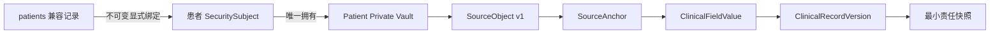
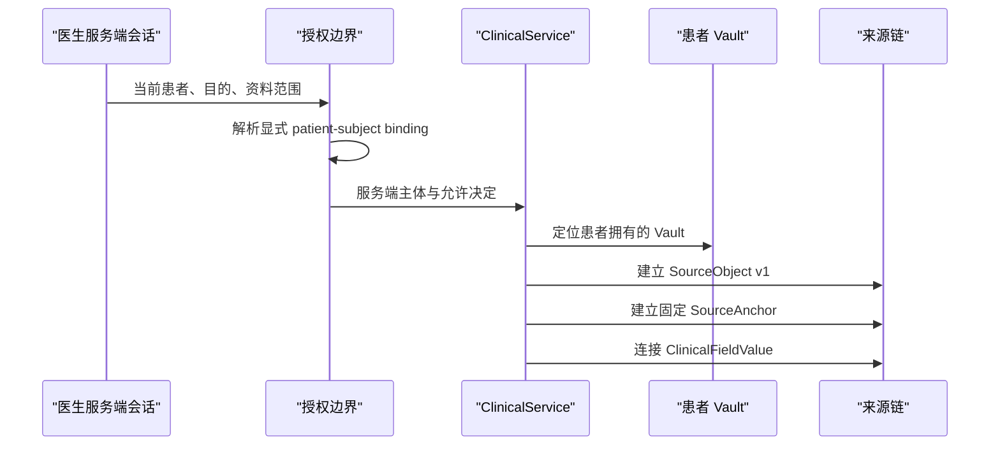

# MAP-DEV-009：患者安全主体、Vault 与来源锚点 0.1

- 状态：`Synthetic Implementation / Human Review Pending`
- 日期：2026-08-13
- 阶段：Gate 1 P0-3
- 适用范围：合成患者、合成安全主体、合成临床记录
- 明确不适用：真实身份、真实病历、真实媒体、生产加密或互联网诊疗

> 2026-08-13 后续状态：本文件记录的 P0-4 授权证据、临床写入和 Outbox 统一事务已由 MAP-DEV-010 在合成 SQLite 运行时完成；生产并发、幂等和投递器仍未完成。

## 1. 本轮结果

MAP-DEV-009 把 Gate 0 文档中的四个关键边界落到 SQLite 合成运行时：

1. `patients` 兼容记录与 `security_subjects` 之间建立不可变显式键；
2. 患者私域由患者安全主体拥有，不再由显示编号暗示所有权；
3. 原始资料登记为不可变 `SourceObject` 版本，并用内容哈希校验；
4. 结构化临床字段通过不可变 `SourceAnchor` 回到特定资料版本。

本轮仍未解除真实数据门禁。`key_reference` 在合成环境必须为空；原始文件字节不进入 `source_objects` 表。

## 2. 关键关系

`display_code` 只用于人类可读的合成编号和兼容迁移，不能再作为授权关联键。医生会话对患者记录执行写入前，必须能解析出 `patient_record_subject_bindings.patient_subject_id`。

## 3. 新增运行时实体

| 实体 | 作用 | 本轮约束 |
|---|---|---|
| `patient_record_subject_bindings` | 将兼容患者记录绑定到患者安全主体 | 患者记录和主体均唯一；数据库禁止更新、删除 |
| `vaults` | 统一描述患者或医生私域 | 当前只实例化患者 Vault；owner 必须是安全主体 |
| `source_objects` | 登记不可变资料版本 | 只存不透明引用、类型、版本、哈希和创建主体，不存文件字节 |
| `source_anchors` | 定位文本、时间、页面区域或整个对象版本 | 固定引用 `source_object_version`；数据库禁止更新、删除 |
| `clinical_field_source_links` | 把临床字段连接到来源对象和锚点 | `anchored` 必须同时有对象与锚点；兼容遗留数据可显式为 `source_pending` |

## 4. 患者记录与安全主体

绑定操作同时检查：

- 患者记录为 `SYN-` 合成记录；
- 安全主体角色为 `patient`；
- 主体已经激活并核验；
- 患者记录和安全主体的合成显示编号一致；
- 该患者记录和该患者安全主体均未绑定其他对象。

绑定后创建或复用一个由该主体拥有的患者私域。数据库触发器阻止原位换绑；未来真实世界的身份合并、账户恢复或监护关系不能通过修改此表完成，必须设计独立、有证据、有审批的迁移事件。

## 5. SourceObject 与 SourceAnchor

### 5.1 SourceObject

当前支持：

- `text`
- `audio`
- `video`
- `image`
- `document`
- `structured_form`
- `external_reference`

合成运行时要求 `storage_reference` 使用 `synthetic://`。表中不保存真实文件字节、公开 URL 或密钥。`content_hash` 采用规范化内容指纹的 SHA-256；`created_by_subject_id` 必须是服务端已知合成主体。

### 5.2 SourceAnchor

当前支持：

- `text_range`：字符区间；
- `time_range`：音视频时间区间；
- `page_bbox`：页码和页面区域；
- `object_version`：整个结构化表单或对象版本。

锚点保存固定的资料对象版本、类型化 JSON 定位、可选合成抽取文本、置信度和版本化转换链。锚点一经创建不可移动到新版资料。

## 6. 临床字段接入

通过服务端会话新建的临床字段现在执行以下路径：

在 P0-3 之前形成且尚未绑定患者安全主体的兼容字段，不伪造来源；系统明确标为 `source_pending`。新修订版本复制旧字段时复用旧的不可变来源对象和锚点，不把同一原始资料冒充成新的来源。

签署责任快照已经扩展为记录 `source_object_id`、`source_anchor_id` 和 `source_link_status`，仍只保留哈希与锚点，不复制患者原文。

## 7. 自动门禁

专项测试覆盖：

- 显式绑定及数据库不可变；
- 仅显示编号相同不能替代绑定；
- 错绑另一患者主体被拒绝；
- 绑定同时建立患者所有的 Vault；
- 已存在的绑定 Vault 被复用而非重复创建；
- SourceObject 不保存用于计算哈希的原始内容；
- SourceAnchor 不可更新；
- 新的会话授权临床字段连接到当前患者 Vault；
- 机器合同保持 `synthetic_only=true`、`production_ready=false`。

## 8. 仍然阻断真实试点的事项

| 阻断项 | 当前缺口 | 下一步 |
|---|---|---|
| 原子授权与写入 | 授权判断和临床写入仍是两个 SQLite 事务 | P0-4 统一事务、授权证据快照和 Outbox |
| 生产身份 | 只有合成主体和本地会话 | 接生产身份、账户恢复和医生资质核验 |
| Vault 加密 | `key_reference=NULL` | KMS 支持的每 Vault 密钥、轮换和职责分离 |
| 文件存储 | 只有 `synthetic://` 不透明引用 | 加密对象存储、恶意文件扫描、安全媒体处理 |
| 模型处理 | 未定义供应商留存和区域边界 | 禁训练、零留存或等效合同及区域审查 |
| 生命周期 | 无生产导出、保留、删除、备份恢复 | 形成策略、自动执行和恢复演练 |
| 审批 | 尚无真人技术/临床/法律批准 | 技术合伙人预审后再进入对应责任人门禁 |

## 9. 请求真人技术合伙人裁决

1. 是否接受 `patients` 仅作为兼容投影，而显式安全主体键成为授权事实源？
2. 是否接受 SourceObject 行不保存原始字节，只保存加密存储引用、哈希和版本元数据？
3. 真实媒体是否采用“每患者 Vault 数据密钥 + KMS 包封密钥”的结构？
4. 账户恢复或主体合并应采用何种双人审批、证据和不可逆风险控制？
5. P0-4 是否按“授权证据快照 + 业务写入 + Outbox 同一事务”作为最低实现？

## 10. 预审结论

MAP-DEV-009 的合成结构可以进入真人技术合伙人预审。它解决了“显示编号映射不是安全键”和“字段来源只是字符串”的两个 Gate 0 高风险问题，但不代表生产 Vault、真实身份或真实临床数据已经可用。真实数据 Gate 保持关闭。
