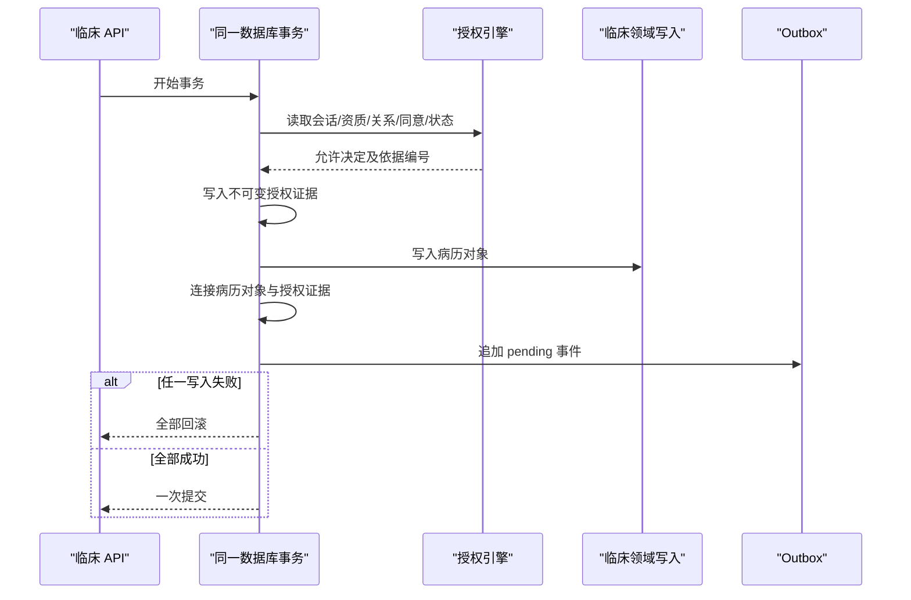

# MAP-DEV-010：授权证据、临床写入与 Outbox 原子事务 0.1

- 状态：`Synthetic Implementation / Human Review Pending`
- 日期：2026-08-13
- 阶段：Gate 1 P0-4
- 数据边界：仅合成身份、合成关系、合成病历和合成来源
- 明确不包含：真实身份、真实病历、生产消息队列或 Outbox 投递器

## 1. 解决的问题

MAP-DEV-007 已把临床 HTTP 写入改为服务端会话授权，但授权判断和临床写入原先分别提交：

```text
授权事务提交 → 权限可能变化 → 临床事务写入
```

该窗口会产生 TOCTOU（检查时与使用时不一致）风险。例如患者在授权通过后、病历写入前撤回同意，旧结构仍可能完成写入。

MAP-DEV-010 把允许决定、证据快照、临床写入、写入证据连接和 Outbox 事件放入同一个 SQLite 事务：



被拒绝的请求不产生允许证据、病历或 Outbox，但拒绝审计会独立提交，避免攻击和误用痕迹因业务拒绝而消失。

## 2. 事务机制

`SQLiteStore.connect()` 现在支持同一执行上下文中的可重入事务：最外层连接负责提交或回滚，身份服务和临床服务的嵌套连接复用同一数据库连接，不提前提交。

当前所有临床会话写路径均通过该边界：

- 创建就诊；
- 追加观察；
- 追加医生判断；
- 医生审核；
- 医生签署；
- 撤回；
- 签署后开始修订。

低层 `ClinicalService` 仍保留给合成种子和迁移使用；HTTP 调用必须经过 `SessionAuthorizedClinicalService`。

## 3. 授权证据快照

`clinical_authorization_evidence` 只保存允许决定，并固化：

- 服务端会话编号；
- 服务端主体与角色；
- 能力；
- 当前患者安全主体；
- 目的与资料类别；
- 授权对象及写入前状态；
- 实际命中的照护关系和患者同意编号；
- 规范化证据清单 SHA-256；
- 决策时间。

客户端 `actor_id` 或 `actor_role` 不进入权威证据。数据库禁止更新或删除证据快照。

## 4. 临床写入证据连接

`clinical_write_evidence_links` 把一次允许证据连接到真正产生的临床对象，例如：

- `encounter / create`
- `observation / append`
- `assessment / append`
- `encounter / transition:signed`
- `encounter / revision:start`

这样可以回答“哪一个服务端授权决定实际产生了哪一个临床对象”，而不是只保留彼此分离的日志。

## 5. Outbox

`clinical_outbox_events` 与病历在同一事务中追加，当前状态固定为 `pending`。事件只包含：

- 授权证据编号；
- 临床对象类型和编号；
- 动作类型；
- 病历状态；
- 记录版本和责任快照编号；
- 规范化 payload 哈希。

Outbox 不保存主诉、观察内容、证候、病机、处方文字或其他患者叙述，`raw_clinical_content_persisted=0`。事件本身禁止更新和删除。

本轮没有实现投递器。未来投递结果不能修改原 Outbox 行，而应追加独立的投递尝试、成功确认或死信事件。

## 6. 故障注入结果

专项测试在数据库中故意安装一个触发器，使 Outbox 插入失败。验证结果：

- 观察记录未增加；
- 允许授权证据未保留；
- 写入证据连接未保留；
- Outbox 未保留；
- 同事务内的允许审计也被回滚。

另一个测试撤回患者同意后发起写入：

- 写入被拒绝；
- 没有允许证据；
- 没有临床写入；
- 没有 Outbox；
- 拒绝授权审计成功保留。

这两个测试共同区分“允许后业务失败必须全回滚”和“拒绝决定必须可审计”。

## 7. 机器门禁

机器合同：`schemas/gate1/atomic-clinical-write-outbox-v0.1.json`

新增专项测试覆盖：

1. 允许证据、临床对象、连接和 Outbox 一一对应；
2. 证据包含实际关系和同意编号；
3. Outbox 失败引发全事务回滚；
4. 拒绝决定提交审计但不产生允许证据；
5. 审核、签署和修订分别产生最小 Outbox；
6. 证据与 Outbox 数据库不可变；
7. 机器合同继续保持 `synthetic_only=true`、`production_ready=false`。

## 8. 仍未完成的生产能力

| 事项 | 当前状态 | 生产前要求 |
|---|---|---|
| 数据库隔离级别 | 单机 SQLite 合成验证 | 在目标数据库验证锁、隔离和并发撤回场景 |
| 幂等性 | 未实现 | 请求幂等键、重复提交结果复用、冲突规则 |
| Outbox 投递器 | 未实现 | 租约、重试、退避、投递尝试、成功确认 |
| 死信治理 | 未实现 | 人工审查、受控重放、责任和审计 |
| 可观测性 | 仅本地审计 | 不含患者内容的指标、追踪和告警 |
| 灾难恢复 | 未实现 | 备份、一致性恢复、Outbox 重放演练 |
| 生产安全 | 未审查 | 压测、故障注入、渗透测试和真人技术批准 |

## 9. 请求真人技术合伙人裁决

1. 目标生产数据库是否选择 PostgreSQL，并以何种隔离级别验证同意撤回与临床写入竞态？
2. 幂等键应由客户端提供并由服务端绑定主体/动作，还是完全由服务端生成？
3. Outbox 投递尝试是否采用追加式独立表，原始事件永不改写？
4. 哪些事件允许进入产品分析，哪些只能留在安全审计域？
5. 死信重放是否必须双人批准，临床签署相关事件是否应采用更高门槛？

## 10. 预审结论

MAP-DEV-010 已在合成 SQLite 运行时消除 MAP-DEV-007 所记录的授权—写入事务窗口，可以进入真人技术合伙人预审。它不等于生产并发、投递、幂等、灾备或真实临床已经准备完成；真实数据 Gate 继续关闭。
