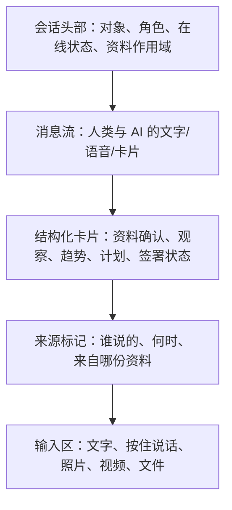
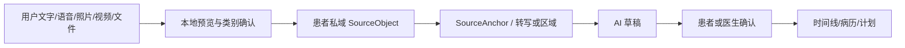

# MAP-UX-002｜对话优先的中医 AI 社区入口 0.1

- 状态：Founder Direction Baseline / Offline Chat Prototype Ready for Retest
- 日期：2026-08-13
- 依据：国内患者合伙人首次自由体验反馈“目前界面功能不清晰，要加注解”
- 数据边界：原型仅使用合成身份和合成多模态引用

## 1. 产品方向

首个客户端不再以“多个功能页面组成的健康后台”为主要心智模型，而以中医爱好者虚拟 AI 社区的入口为主要心智模型。使用者进入后首先看到自己正在与谁交流、对方能做什么、当前资料作用域是什么，并直接通过文字、语音或文件开始互动。

```text
旧入口：先理解菜单 → 找到功能 → 填写表单 → 等待结果
新入口：进入社区 → 选择/确认交流对象 → 自然表达 → 对话中确认结构化结果
```

对话框是入口和主要工作台，不是唯一数据结构。病历、资料来源、行动计划、趋势和医生签署仍以结构化卡片嵌入对话，并进入对应的私域、临床记录或时间线。

## 2. 第一屏必须回答四个问题

1. 我现在在和谁交流？
2. 它是什么角色，能做什么、不能做什么？
3. 我可以用什么方式表达？
4. 我刚才发送的内容会去哪里？

即使未来社区成员已经了解 MAP，客户端仍必须让这些信息在当前会话中一眼可见，不能依赖外部培训或说明书。

## 3. 会话对象

| 会话对象 | 面向谁 | 主要作用 | 权限边界 |
|---|---|---|---|
| 患者健康辅导员 | 患者/中医爱好者 | 倾听、整理、健康学习、行动提醒、复盘 | 不独立诊断、开方或改药 |
| 医师智能体徒弟 | 绑定真人医师 | 整理四诊资料、呈现老师框架、准备可审查草稿 | 不代替老师签署，不永久占有患者资料 |
| 真人医师会话 | 有效照护关系中的患者 | 医生接诊、判断、方案和签署 | 由现实医生承担临床决定与责任 |
| 社区主题/智能体小组 | 社区成员 | 学习、讨论、经验贡献和争议保留 | 不把讨论自动升级为医疗结论 |

首版先实现一对一患者健康辅导员会话和医生端医师徒弟会话；群组、智能体协作和社区广场后置。

## 4. 对话界面结构



### 会话头部

- 清楚显示交流对象名称和角色，例如“我的健康辅导员（AI）”；
- AI、真人医生、患者和社区成员必须有不同且持续可见的身份标记；
- 显示当前会话是私人、照护关系内还是社区公开讨论；
- 提供“它能做什么”和“资料使用范围”的轻量入口。

### 消息流

- 支持自然文字；
- 语音显示原音频引用和可修改转写；
- 图片、视频和文档先显示本地预览、资料类别与是否发送确认；
- AI 的整理结果标明“AI 草稿”，用户或医生可以确认、纠正或拒绝；
- 危险信号只触发安全出口和人工联系建议，不由 AI 自主诊疗。

### 输入区

首版视觉上保留五个高频动作：

1. 文字输入；
2. 按住说话/语音转文字；
3. 拍照或选择图片；
4. 视频/文件；
5. 发送。

当前离线原型只模拟选择和本地预览，不上传、不调用麦克风、不保存真实内容。

## 5. 结构化卡片

对话中的关键结果不能只成为聊天文字，应转换为可确认的卡片：

| 卡片 | 谁确认 | 去向 |
|---|---|---|
| “我理解的是……”资料确认 | 患者 | 患者 Vault 来源事实 |
| 今日观察 | 患者，可由医生后续确认 | 健康时间线 |
| 趋势变化 | 患者核对；AI 仅草稿 | 派生知识 |
| 医生判断草稿 | 真人医生 | 临床记录草稿 |
| 行动计划 | 医生签署或患者自我学习 | 干预/学习计划 |
| 复诊差异 | 患者和医生分别确认各自部分 | 新 ClinicalRecordVersion |

卡片必须允许“确认、修改、不是这个意思”，避免 AI 的概括静默成为事实。

## 6. 多模态资料路径



任何多模态输入都必须保留来源对象和锚点。原始资料与 AI 转写/识别分层保存；识别错误通过追加式更正处理。

## 7. 第一轮原型验收

邀请测试者自由体验后，只问三个自然语言问题：

1. 第一眼觉得正在和谁交流、它能做什么？
2. 你是否知道如何说话、打字或发送资料？
3. 哪一条 AI 回复或卡片让你愿意继续，哪一条让你困惑或不信任？

通过条件：

- 无人讲解时，测试者能在 10 秒内说出当前会话对象和主要作用；
- 能在 30 秒内开始一次合成文字或语音式互动；
- 能区分 AI 草稿、患者确认和医生签署；
- 能找到资料作用域，并知道原型禁止真实病历；
- 不再依赖侧栏菜单理解产品是什么。

## 8. 实施顺序

1. 把离线原型首页改为患者健康辅导员对话；
2. 在消息流内嵌“资料确认、今日观察、行动计划”合成卡片；
3. 增加语音、图片、视频、文件的本地模拟入口；
4. 保留现有趋势、病历和授权页面，但降为对话卡片的详情层；
5. 医生端改为“医师徒弟会话 + 当前患者临时会诊作用域”；
6. 完成离线可达性与自然语言体验复测后，再决定在线独立域名版本。

## 9. 明确后置

- 真实语音识别、图片 OCR、视频解析；
- 真实文件上传和云端对象存储；
- 社区公开动态、群聊和智能体自动互聊；
- AI 自主诊断、处方、签署或紧急分诊；
- 用聊天记录替代不可变临床记录。
